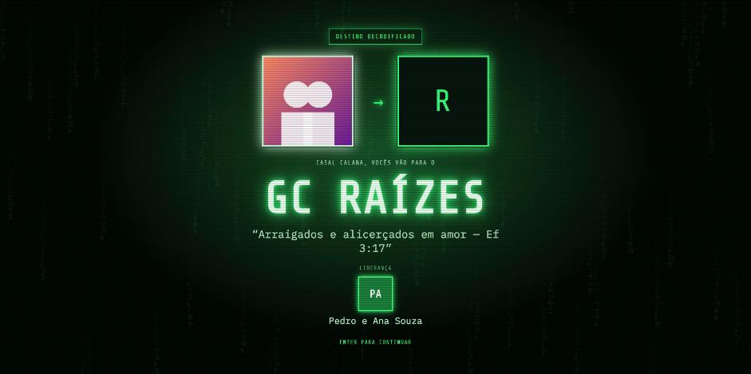
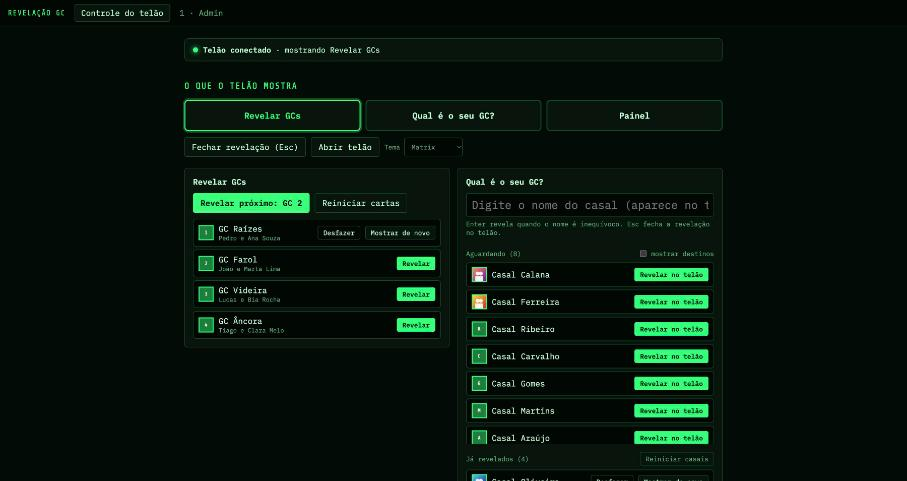
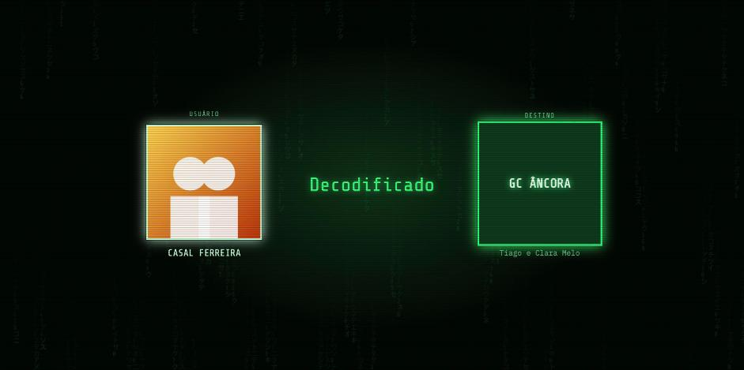
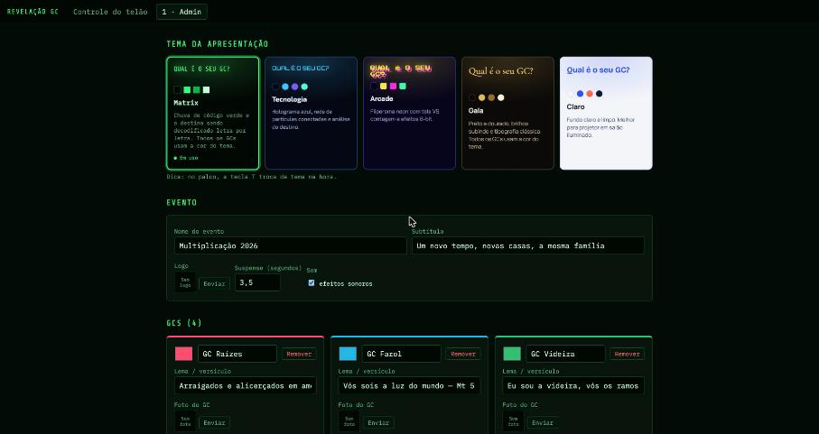
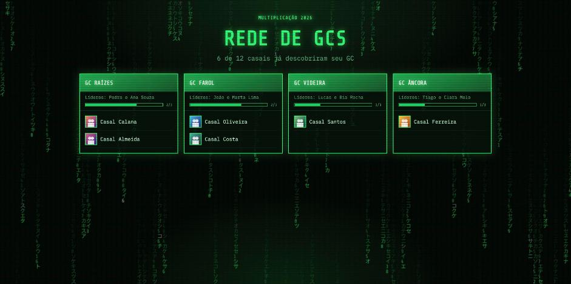

# Revelação dos GCs

Aplicativo para o momento de revelação da **multiplicação dos GCs**. Ele mostra no telão:
- os novos GCs, com nome, lema e líderes;
- a cada casal, com animação de suspense, o GC para onde vai.

O destino de cada casal é cadastrado antes, e a animação só cria expectativa: **não há sorteio**.



- **Duas janelas:** o operador controla tudo pelo notebook e o telão mostra só a apresentação, em tela cheia no projetor.
- **5 temas:** Matrix, Tecnologia, Arcade, Gala e Claro.
- **Fotos dos casais e dos líderes.** Também aceita vídeo antes da revelação de cada GC.
- **Funciona sem internet:** dados, fotos e fontes ficam no próprio computador.
- **Windows, macOS e Linux.**

## Download

Baixe a versão mais recente em **[Releases](../../releases/latest)**:

| Sistema | Arquivo |
|---|---|
| Windows 10/11 (64 bits) | `Revelacao-GC-windows-x64.exe` |
| macOS com Apple Silicon (M1, M2, M3, M4) | `Revelacao-GC-macos-arm64.zip` |
| Linux 64 bits (Ubuntu 22.04 ou mais novo) | `Revelacao-GC-linux-x64.tar.gz` |

**[📖 Tutorial completo: instalação, preparação do evento e uso no dia](docs/TUTORIAL.md)**

## Telas

| Janela do operador | Telão: suspense |
|---|---|
|  |  |

| Admin: temas e evento | Telão: painel final |
|---|---|
|  |  |

## Para desenvolvedores

Requisitos: [uv](https://docs.astral.sh/uv/) e Python 3.12 ou mais novo (no Windows, use 3.13).

Rodar em desenvolvimento:

```
uv sync && uv run main.py
```

Gerar o pacote do sistema atual em `dist/pacotes/`:

```
uv run python scripts/build.py
```

Testar o pacote gerado (abre o app e confere servidor, telão e operador):

```
uv run python scripts/teste_fumaca.py
```

Variáveis de ambiente úteis:

| Variável | Para que serve |
|---|---|
| `REVELACAO_DADOS` | Usa outra pasta de dados |
| `REVELACAO_PORTA` | Fixa a porta do servidor interno |
| `REVELACAO_SEM_JANELA=1` | Só o servidor, sem janelas. Abra `http://127.0.0.1:<porta>/?modo=operador` e `?modo=telao` no navegador |

### Como funciona

- **`revelacao/app.py`** sobe a API local (FastAPI + uvicorn) em `127.0.0.1` e abre duas janelas com [pywebview](https://pywebview.flowrl.com/):
  - motor de cada sistema: WebKit no macOS, Edge WebView2 no Windows, Qt WebEngine no Linux;
  - janela do operador: `?modo=operador`;
  - janela do telão: `?modo=telao`, na segunda tela, se houver.
- **`revelacao/servidor.py`** é a API:
  - configuração do evento;
  - mídias;
  - backup em `.zip`;
  - canal de eventos (Server-Sent Events) por onde o operador comanda o telão.
- **`revelacao/banco.py`** guarda a configuração no SQLite e as mídias numa pasta `midia/` ao lado.
- **`revelacao/static/index.html`** contém todas as telas (Admin, Controle, Revelar GCs, Qual é o seu GC?, Painel) e os temas.
- **`revelacao/static/fonts/`** tem as fontes embutidas. Para atualizar: `uv run python scripts/baixar_fontes.py`.
- **`prototipo.html`** é uma versão de arquivo único que roda direto no navegador, sem as duas janelas.

### Publicar uma versão

O workflow [`.github/workflows/build.yml`](.github/workflows/build.yml):
- empacota e testa nos 3 sistemas a cada push na `main`;
- quando recebe uma tag `v*`, cria a Release com os 3 arquivos.

```
git tag v1.0.1 && git push origin v1.0.1
```
