# Tutorial: Revelação dos GCs

Este guia leva você do download até o fim do evento. Não precisa saber programar.

**Sumário**

1. [Do que você precisa](#1-do-que-você-precisa)
2. [Baixar](#2-baixar)
3. [Instalar e abrir](#3-instalar-e-abrir) ([Windows](#windows), [macOS](#macos), [Linux](#linux))
4. [As duas janelas](#4-as-duas-janelas)
5. [Preparar o evento (Admin)](#5-preparar-o-evento-admin)
6. [Ensaiar](#6-ensaiar)
7. [No dia do evento](#7-no-dia-do-evento)
8. [Reiniciar e desfazer](#8-reiniciar-e-desfazer)
9. [Atalhos de teclado](#9-atalhos-de-teclado)
10. [Levar para outro computador (backup)](#10-levar-para-outro-computador-backup)
11. [Problemas comuns](#11-problemas-comuns)

---

## 1. Do que você precisa

- **Um computador** com Windows 10/11, macOS (Mac com chip Apple M1 ou mais novo) ou Linux.
- **Um projetor ou TV ligado como segunda tela.** Dá para usar sem, mas a graça é o telão.
- **Som** (opcional). Os efeitos sonoros saem pelo computador; ligue o áudio na caixa de som da igreja.
- **Internet só para baixar.** Durante o evento, o app funciona offline.

## 2. Baixar

1. Entre na página de **[Releases](../../../releases/latest)** do projeto.
2. Em **Assets**, baixe o arquivo do seu sistema:

| Sistema | Arquivo |
|---|---|
| Windows | `Revelacao-GC-windows-x64.exe` |
| macOS | `Revelacao-GC-macos-arm64.zip` |
| Linux | `Revelacao-GC-linux-x64.tar.gz` |

> **Mac com processador Intel** (anterior a 2020): a versão pronta não roda nele. Veja [Problemas comuns](#11-problemas-comuns).

## 3. Instalar e abrir

O app não é assinado por uma empresa (isso é pago). Por isso, **na primeira vez** o sistema pede uma confirmação extra. Depois disso, abre normalmente.

### Windows

1. Crie uma pasta, por exemplo `Documentos\Revelacao GC`, e mova para ela o `Revelacao-GC-windows-x64.exe`.
2. Dê dois cliques no arquivo.
3. Se aparecer **"O Windows protegeu o computador"** (SmartScreen):
   1. clique em **Mais informações**;
   2. clique em **Executar assim mesmo**.
4. Abrem duas janelas: **Operador** e **Telão**. A primeira abertura pode levar uns 10 segundos.

Para ter um atalho na área de trabalho: clique com o botão direito no `.exe` → **Mostrar mais opções** → **Enviar para** → **Área de trabalho (criar atalho)**.

> Se a janela abrir **em branco**, falta o *Microsoft Edge WebView2*. Veja [Problemas comuns](#11-problemas-comuns).

### macOS

1. Dê dois cliques no `Revelacao-GC-macos-arm64.zip` para descompactar. Aparece o **Revelacao GC**.
2. Arraste o **Revelacao GC** para a pasta **Aplicativos**.
3. Abra o app pela pasta Aplicativos. Na primeira vez, o macOS avisa que **não pode verificar o desenvolvedor**:
   1. clique em **OK** (ou **Concluído**);
   2. abra **Ajustes do Sistema** → **Privacidade e Segurança**;
   3. role até o fim e clique em **Abrir Mesmo Assim** ao lado de "Revelacao GC";
   4. confirme com sua senha e clique em **Abrir**.
4. Abrem duas janelas: **Operador** e **Telão**.

<details>
<summary>Atalho pelo Terminal (opcional)</summary>

Se preferir, este comando libera o app de uma vez:

```
xattr -dr com.apple.quarantine "/Applications/Revelacao GC.app"
```
</details>

### Linux

1. Abra o terminal na pasta do download e descompacte:

   ```
   tar -xzf Revelacao-GC-linux-x64.tar.gz
   ```

2. Rode:

   ```
   ./revelacao-gc/revelacao-gc
   ```

3. Se der erro de biblioteca (por exemplo `libxcb-cursor`), instale as dependências. No Ubuntu/Debian:

   ```
   sudo apt install libxcb-cursor0 libxkbcommon-x11-0 libegl1 libnss3
   ```

Para ter um ícone no menu, crie o arquivo `~/.local/share/applications/revelacao-gc.desktop` com o conteúdo abaixo. Troque `/caminho/para` pela pasta onde descompactou.

```
[Desktop Entry]
Name=Revelação dos GCs
Exec=/caminho/para/revelacao-gc/revelacao-gc
Type=Application
Categories=Utility;
```

## 4. As duas janelas

Ao abrir o app, aparecem duas janelas. Fechar a do **Operador** fecha o app inteiro.

**Operador** (fica no notebook, só você vê):
- **Controle do telão:** decide o que aparece no telão e dispara as revelações.
- **Admin:** cadastro do evento, dos GCs e dos casais, além de tema, backup e reinício.

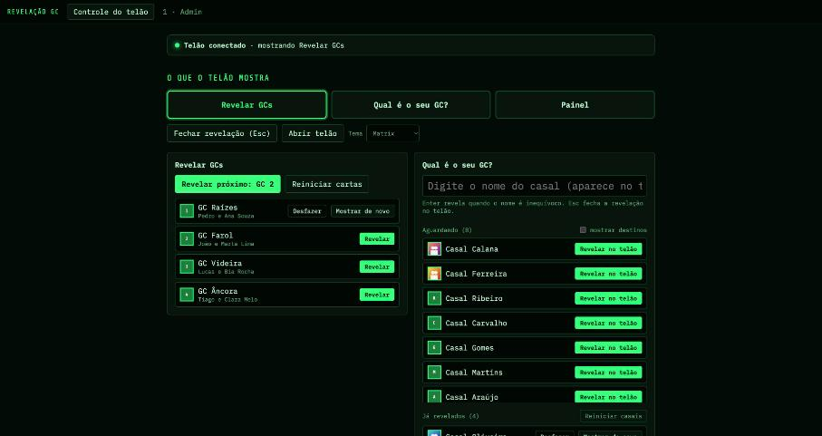

**Telão** (vai para o projetor, todo mundo vê):
- não tem menu nem cursor, só a apresentação;
- se houver uma segunda tela ligada, ele abre nela **em tela cheia**;
- sem segunda tela, abre como janela comum: arraste para o projetor e clique em **Tela cheia do telão** no operador.

O telão tem três telas:

| Revelar GCs | Qual é o seu GC? | Painel |
|---|---|---|
| 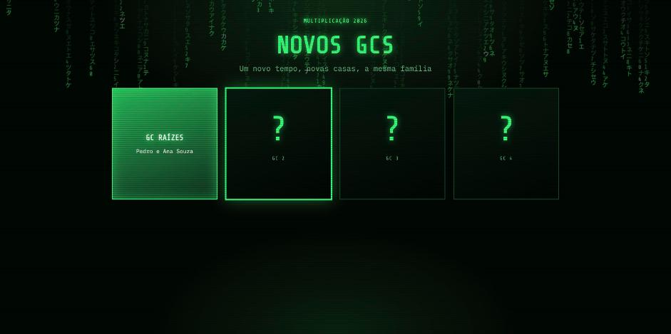 | 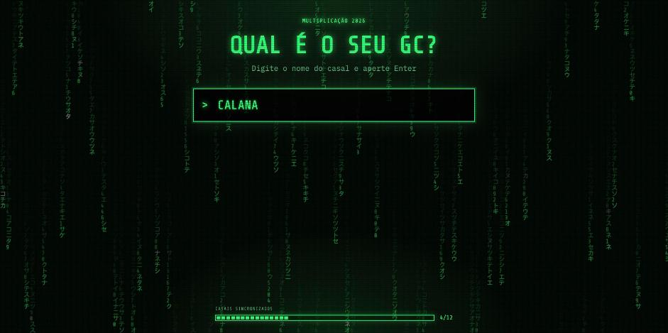 | 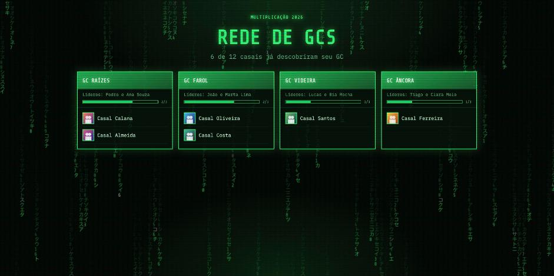 |

## 5. Preparar o evento (Admin)

Na janela do Operador, clique em **Admin**. Tudo é salvo sozinho: aparece "Salvo" no canto inferior direito.

O app abre com **dados de exemplo** (4 GCs e 12 casais fictícios) para você ensaiar. Quando for cadastrar o evento real, use **Reiniciar → Apagar cadastro** (seção 8) e comece do zero.

### 5.1 Tema

No topo do Admin, clique no tema desejado. Dá para trocar a qualquer momento, inclusive durante o evento.

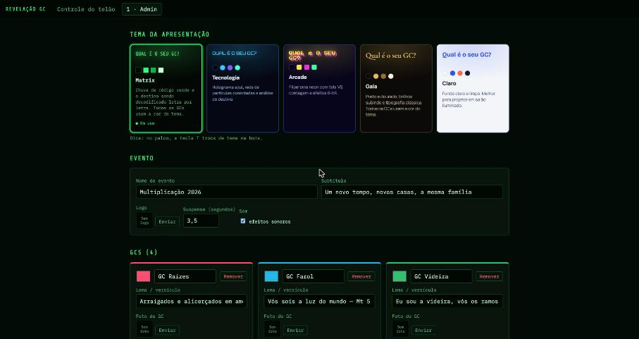

| Tema | Estilo |
|---|---|
| **Matrix** | Chuva de código verde; o destino é "decodificado" letra por letra |
| **Tecnologia** | Holograma azul com rede de partículas |
| **Arcade** | Fliperama neon com tela "VS" e sons 8-bit |
| **Gala** | Preto e dourado, com brilhos e letras clássicas |
| **Claro** | Fundo claro e limpo; melhor para salão muito iluminado |

| Tecnologia | Arcade | Gala | Claro |
|---|---|---|---|
| 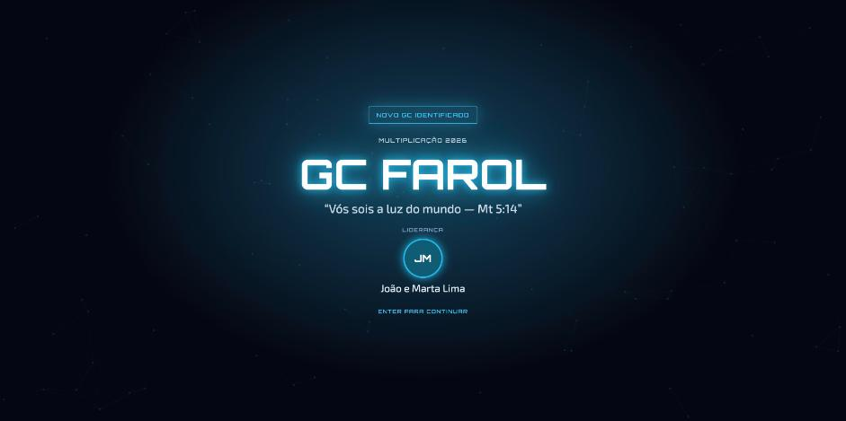 |  |  | 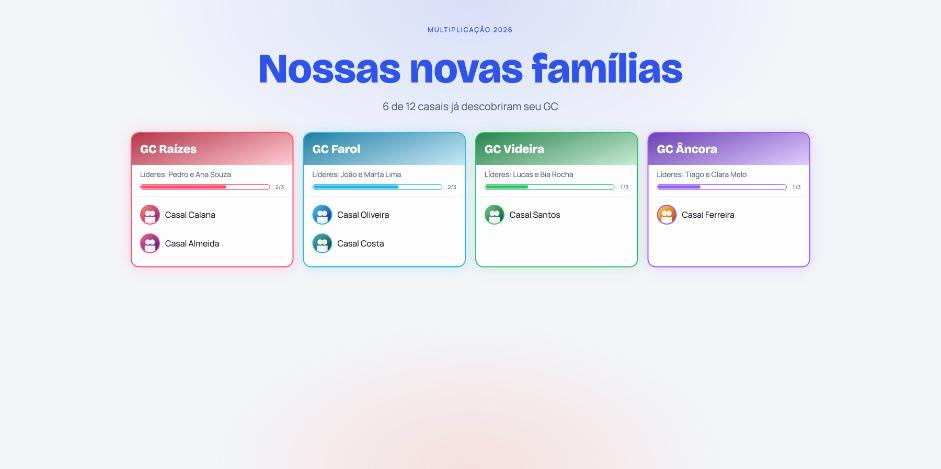 |

> Nos temas **Matrix** e **Gala**, todos os GCs usam a cor do tema. Nos outros, cada GC aparece com a cor que você escolher.

### 5.2 Evento

- **Nome do evento** e **subtítulo:** aparecem no topo do telão.
- **Logo:** imagem da igreja ou do tema da multiplicação (PNG com fundo transparente fica melhor).
- **Suspense (segundos):** quanto tempo dura a animação antes de mostrar o GC. O padrão é 3,5; entre 3 e 5 funciona bem.
- **Efeitos sonoros:** liga ou desliga os sons.

### 5.3 GCs

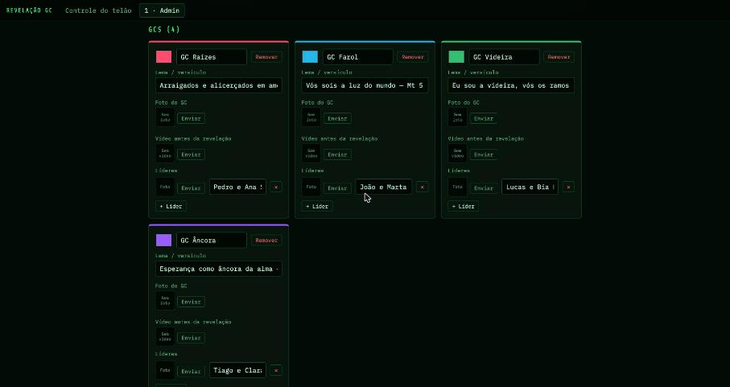

Para cada GC:

1. **Cor:** clique no quadradinho colorido.
2. **Nome:** por exemplo, "GC Raízes".
3. **Lema / versículo:** aparece em itálico na revelação (opcional).
4. **Foto do GC:** aparece na carta e na revelação (opcional).
5. **Vídeo antes da revelação** (opcional): por exemplo, um recado gravado pelos líderes. Ele toca em tela cheia antes da carta virar. Enter ou clique pula o vídeo.
6. **Líderes:** nome (por exemplo, "Pedro e Ana") e foto. Use **+ Líder** para mais de um casal de líderes.

Use **+ Novo GC** para adicionar e **Remover** para excluir.

### 5.4 Casais

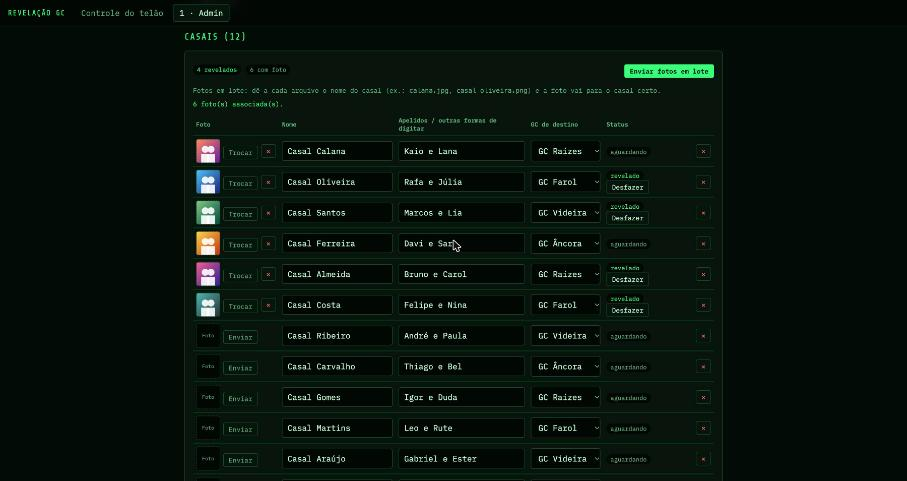

Cada linha é um casal:

- **Nome:** como vai aparecer no telão, por exemplo "Casal Calana".
- **Apelidos / outras formas de digitar:** outros jeitos de achar o casal, separados por vírgula, por exemplo `Kaio e Lana, Calanas`. A busca já ignora acentos, maiúsculas e a palavra "casal", e tolera pequenos erros de digitação.
- **GC de destino:** para onde o casal vai. **É isso que será revelado.**
- **Foto:** aparece na tela de suspense e na revelação.

Use **+ Casal** para adicionar e **✕** para excluir.

### 5.5 Fotos em lote (o jeito rápido)

1. Junte as fotos numa pasta.
2. Renomeie cada arquivo com o nome do casal, por exemplo `calana.jpg`, `casal oliveira.png` ou `santos.jpeg`.
3. Clique em **Enviar fotos em lote** e selecione todas.
4. O app associa cada foto ao casal certo e avisa quais arquivos não encontraram dono.

Dica: fotos quadradas ou com o casal no centro ficam melhores.

### 5.6 Importar a lista de uma planilha

Se você já tem os casais no Excel ou no Google Planilhas:

1. Monte três colunas: **Nome do casal**, **Nome do GC** e **Apelidos** (opcional).
2. Selecione as linhas e copie (Ctrl+C / Cmd+C).
3. Em **Importar lista**, cole na caixa de texto e clique em **Importar casais**.

Também aceita texto separado por ponto e vírgula:

```
Casal Calana;GC Raízes;Kaio e Lana
Casal Oliveira;GC Farol;Rafa e Júlia
```

- GCs que ainda não existem são criados na hora (depois, complete líderes e cores).
- Casais que já existem são atualizados.

## 6. Ensaiar

Faça pelo menos um ensaio **no computador e no projetor do evento**:

- [ ] O telão abriu no projetor, em tela cheia
- [ ] Dá para ler os nomes do fundo do salão (se não, teste o tema **Claro**)
- [ ] O som sai na caixa de som
- [ ] As fotos dos casais aparecem
- [ ] A busca acha os casais pelo nome que eles vão falar
- [ ] Depois do ensaio: **Reiniciar → Evento inteiro** (volta tudo ao início, sem apagar o cadastro)
- [ ] Exportou um **backup** (seção 10)

## 7. No dia do evento

### 7.1 Ligando tudo

1. Conecte o projetor e configure como **tela estendida**, não espelhada:
   - **Windows:** tecla `Windows + P` → **Estender**.
   - **macOS:** Ajustes do Sistema → Telas → escolha o projetor e use como **Tela estendida**.
2. Abra o app. O **Telão** vai para o projetor em tela cheia, e o **Operador** fica no notebook.
3. No topo do Controle, confira **"Telão conectado"** com a bolinha verde.

### 7.2 Revelando os GCs

1. No Controle, clique em **Revelar GCs** (em "O que o telão mostra"). O telão mostra as cartas fechadas.
2. Clique em **Revelar próximo**, ou em **Revelar** ao lado de um GC específico. No telão:
   1. toca o vídeo, se houver;
   2. a carta vira;
   3. aparece a revelação com nome, lema e líderes, com confete e som.
3. Aperte **Esc** (ou **Fechar revelação**) para voltar às cartas.
4. Repita para cada GC.

### 7.3 "Qual é o seu GC?": os casais

1. Clique em **Qual é o seu GC?**.
2. Quando um casal se apresentar, digite o nome no campo do Controle. **O que você digita aparece ao vivo no telão.**
3. Aperte **Enter**. Se houver mais de um casal parecido, clique no certo na lista.
4. O telão faz o suspense:
   1. contagem 3, 2, 1;
   2. foto do casal de um lado e o destino "embaralhando" do outro;
   3. revelação do GC com os líderes.

   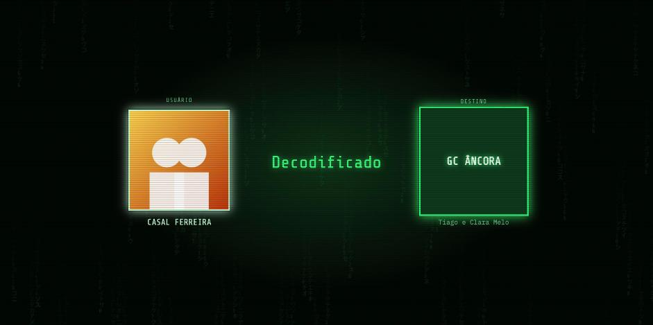
   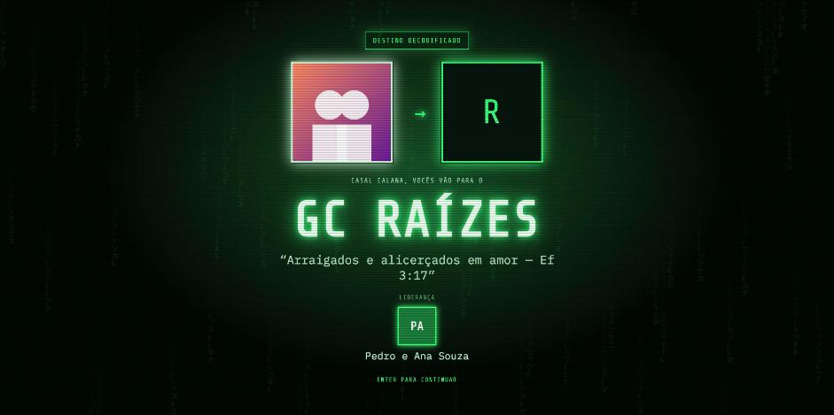
5. Aperte **Esc** para voltar à tela de digitação e chamar o próximo casal.

Outras formas de revelar:
- clicar em **Revelar no telão** na lista **Aguardando**;
- usar **Mostrar de novo**, em **Já revelados**, para repetir a revelação de um casal.

> Os destinos ficam escondidos na lista do operador para ninguém espiar o notebook. Para conferir, marque **mostrar destinos**.

### 7.4 Encerrando

Clique em **Painel**: o telão mostra todos os GCs com os casais que já descobriram seu destino.

## 8. Reiniciar e desfazer

A seção **Reiniciar** fica no fim do Controle e também no Admin:

| Opção | O que faz | O que **não** muda |
|---|---|---|
| **Cartas dos GCs** | Fecha de novo todas as cartas | Casais e cadastro |
| **Casais** | Todos voltam para "aguardando" e o Painel fica vazio | Cartas e cadastro |
| **Evento inteiro** | Cartas e casais voltam ao início (use depois do ensaio) | GCs, casais, fotos e vídeos |
| **Apagar cadastro** ⚠️ | Remove GCs, casais, fotos e vídeos | Nome do evento, logo e tema |
| **Dados de exemplo** ⚠️ | Troca tudo pelos dados fictícios | O tema |

Todas pedem confirmação. As duas marcadas com ⚠️ não podem ser desfeitas: exporte um backup antes.

Para voltar **um item só**, use o botão **Desfazer** ao lado do GC ou do casal já revelado, no Controle ou na tabela de casais do Admin.

## 9. Atalhos de teclado

Na janela do **Operador**:

| Tecla | Ação |
|---|---|
| `Enter` (no campo do casal) | Revela o casal digitado |
| `Esc` | Fecha a revelação no telão |

Na janela do **Telão**, se precisar usar direto nela:

| Tecla | Ação |
|---|---|
| `F` | Tela cheia |
| `T` | Troca de tema |
| `Espaço` | Revela o próximo GC |
| `Enter` / `Esc` | Fecha a revelação |

## 10. Levar para outro computador (backup)

1. No Admin, em **Backup**, clique em **Exportar backup (.zip)** e escolha onde salvar. O arquivo leva tudo: cadastro, fotos, vídeos e tema.
2. No outro computador, instale o app, vá em **Importar backup** e escolha o `.zip`.

Os dados ficam guardados em:

| Sistema | Pasta |
|---|---|
| Windows | `%APPDATA%\Revelacao GC` |
| macOS | `~/Library/Application Support/Revelacao GC` |
| Linux | `~/.local/share/revelacao-gc` |

## 11. Problemas comuns

**O telão abriu na tela errada (ou no notebook)**
- Confira se o projetor está como **tela estendida** (seção 7.1) e reabra o app.
- Ou arraste a janela do telão para o projetor e clique em **Tela cheia do telão** no operador.

**O operador mostra "Telão desconectado"**
- Clique em **Abrir telão**. Se a janela do telão foi fechada, ela reabre.

**Não sai som**
- Confira se **Efeitos sonoros** está marcado no Admin.
- Confira a saída de áudio do computador: o som sai pelo computador onde o app está aberto, não pelo projetor, a menos que o cabo HDMI leve o áudio.

**O casal não foi encontrado**
- Tente o sobrenome.
- Cadastre como o casal costuma ser chamado em **Apelidos**.
- Como último recurso, use **Revelar no telão** direto na lista **Aguardando**.

**Windows: janela branca ou o app não abre**
- Instale o **Microsoft Edge WebView2 Runtime** (gratuito): <https://developer.microsoft.com/microsoft-edge/webview2/>. Escolha *Evergreen Standalone Installer*, x64.

**macOS: "o app está danificado" ou "não pode ser aberto"**
- Siga o passo 3 de [macOS](#macos) (Privacidade e Segurança → Abrir Mesmo Assim) ou use o comando do Terminal mostrado lá.

**Mac com processador Intel**
- A versão pronta é só para Apple Silicon. Para gerar uma versão Intel, rode o projeto a partir do código-fonte (veja o [README](../README.md#para-desenvolvedores)) num Mac Intel.

**Linux: erro de biblioteca ao abrir**
- Instale as bibliotecas do passo 3 de [Linux](#linux).

**Quero recomeçar do zero**
- No Admin, use **Reiniciar → Apagar cadastro**. Para limpar absolutamente tudo, feche o app e apague a pasta de dados da seção 10.
